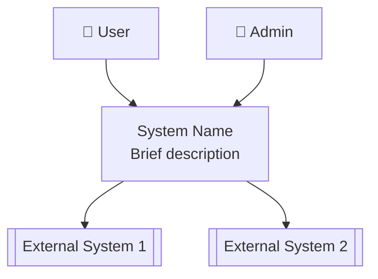
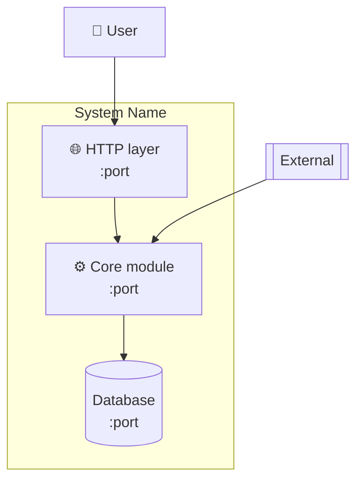
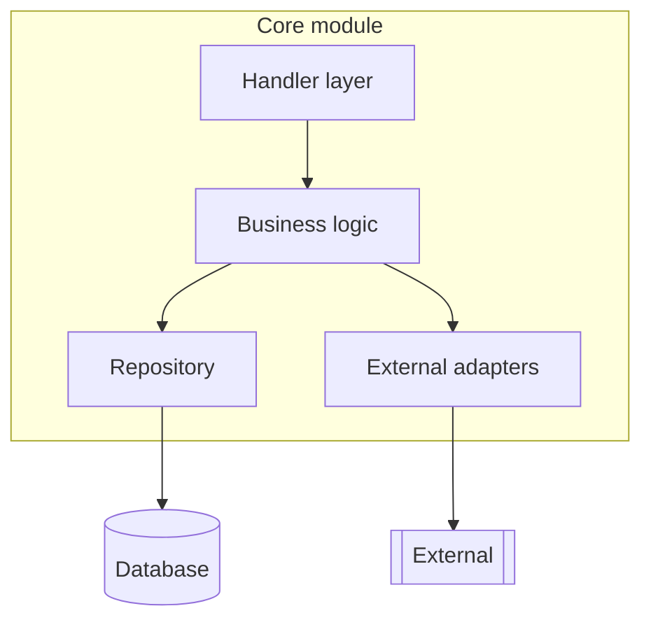
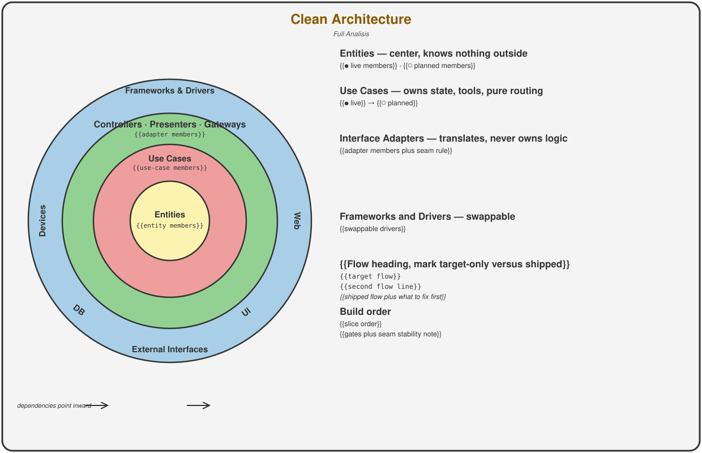
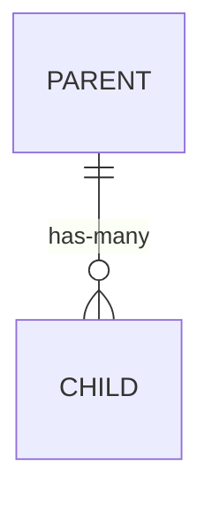
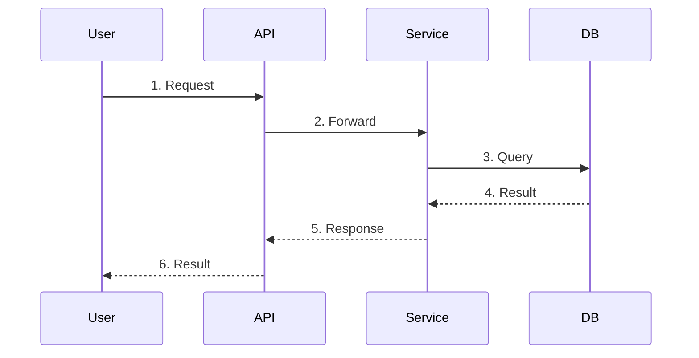
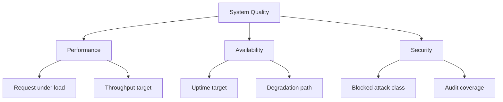

# 02 Architecture - arc42

<!--
Update metadata on every meaningful change.
Keep section headings stable, they serve as anchors for links from code and ADRs.
-->

- Version: {{1.0}}
- Owner: {{Name or Team}}
- Status: Draft or Active or Deprecated
- Last updated: {{YYYY-MM-DD}}

<!--
SDLC POSITION: This template is step 2 of 9 and covers software architecture only.
It consumes 01-Requirements and feeds 03-System-Design plus 04-Plan.
It does NOT duplicate requirements, scale and deployment, task splits, or test cases.
Those live in 01, 03, 04, and 06 respectively.
Scale and deployment decisions live in 03-System-Design, not here.
SCALABLE DETAIL: not every project needs all sections.
MVP or prototype: Overview plus Context (C1) plus key ADRs.
Production service: add Building Blocks plus Code Rules plus Crosscutting.
Complex system: full document.
Delete subsections that do not apply, keep headings stable for link anchors.
-->

## Overview

<!--
PURPOSE: 2-3 sentences that answer "what is this system and what does this document lock".
AUDIENCE: Anyone who lands on this document.
-->

{{Brief description of the system and its high-level architecture style}}.
{{Which slices or milestones this document covers, with a link to 01-Requirements}}.

---

## Document Navigation

| Sections | Content | Audience |
|----------|---------|----------|
| 1-4 | Goals, constraints, context, strategy | Product, new team members |
| 5-7 | Building blocks, runtime flows, code rules | Developers, DevOps |
| 8 | Security, observability, error handling | All technical roles |
| 9-11 | Decisions, quality scenarios, systemic risks | Tech leads, architects |
| 12 | Vocabulary pointer | Everyone |

---

## 1. Goals and Scope Pointer

<!--
PURPOSE: Point at 01-Requirements instead of duplicating it.
RULE: No Business, Functional, or Non-functional requirement lists here.
Requirements live in 01, scale and deployment live in 03-System-Design.
This section holds only quality goals plus the scope link.
-->

### 1.1 Scope Pointer

- Requirements source: {{link to 01-Requirements, e.g. wiki or docs path}}.
- In scope for this architecture: {{slices or milestones, e.g. S0 to S8}}.
- Deferred detail: module cards in section 5.5, scale and deployment in 03-System-Design, task split in 04-Plan.

### 1.2 Quality Goals

<!--
PURPOSE: Force explicit tradeoffs, you cannot optimize everything.
TIPS: Pick top 3 to 5, order matters, first is most important.
RULE: State which goal wins when goals conflict.
Quality scenarios in section 10 turn these goals into numbers, 06-Review-QA verifies them.
-->

| Priority | Goal | Metric |
|----------|------|--------|
| 1 | **{{Primary quality}}** | {{How you measure it}} |
| 2 | **{{Secondary quality}}** | {{How you measure it}} |
| 3 | **{{Tertiary quality}}** | {{How you measure it}} |

- When goals conflict {{which goal}} wins over {{which goal}}.

---

## 2. Constraints

<!--
PURPOSE: Document non-negotiable boundaries to prevent wasted effort on unworkable solutions.
Keep architecture-level constraints here, open questions stay in 01 section 7.
-->

### 2.1 Technical Constraints

- **Language**: {{e.g. Python 3.11+, uv-only toolchain}}.
- **Deploy contract**: {{e.g. which file maps which name to which variable}}.
- **Layout**: {{e.g. loop-first, which directories exist and which are planned}}.
- **Database**: {{e.g. Postgres 15 plus pgvector, what is live and what is planned}}.
- **Current truth**: {{What exists today versus what is planned}}.

### 2.2 Organizational Constraints

- **Team**: {{Size, key skills, availability}}.
- **Process**: {{Slice order, decision records landing with which slices}}.
- **Docs**: {{Matching doc updates ship in the same diff as code plus config plus layout changes}}.
- **Timeline**: {{Hard deadlines, phased delivery}}.

### 2.3 External Constraints

- **Compliance**: {{GDPR, password rules, token rules, etc}}.
- **Standards**: {{JWT, OAuth 2.0, etc}}.
- **SLAs**: {{External dependencies, rate limits, fallibility assumptions}}.

---

## 3. Context and Scope

<!--
PURPOSE: Define system boundaries, what is inside versus outside.
C4 Level 1 shows your system as a box with users and external systems, no internals.
-->

### 3.1 System Context (C1)

### 3.2 Technical Context

| External System | Protocol | Purpose |
|-----------------|----------|---------|
| {{System 1}} | {{REST, gRPC, HTTPS, scrape, etc}} | {{What data or functionality}} |
| {{System 2}} | {{Protocol}} | {{Purpose}} |

### 3.3 Responsibility Boundary

<!--
WHEN TO INCLUDE: Keep when ownership between layers is a real confusion risk, delete otherwise.
Per-module responsibility detail lives in section 5.5, keep this at the seam level only.
-->

- {{Module A}} handles {{what}} and does NOT handle {{what}}.
- {{Module B}} handles {{what}} and does NOT handle {{what}}.

---

## 4. Solution Strategy

<!--
PURPOSE: Explain WHY this approach won over alternatives, decisions without context become arbitrary constraints.
Full decision records live in section 9, keep this at strategy level.
-->

### 4.1 Architectural Approach

| Pattern | Rationale |
|---------|-----------|
| {{Pattern 1}} | {{Why this over alternatives}} |
| {{Pattern 2}} | {{Why this over alternatives}} |

### 4.2 Technology Choices

| Aspect | Choice | Rationale |
|--------|--------|-----------|
| {{Language}} | {{Choice}} | {{Why}} |
| {{Database}} | {{Choice}} | {{Why}} |
| {{Communication}} | {{Choice}} | {{Why}} |

### 4.3 Why {{Chosen}} Over {{Rejected}}

<!--
RULE: Record why the rejected alternative lost, not only why the winner won.
Delete this subsection when no significant alternative was considered.
-->

{{What the rejected approach would have cost}}.
{{Which requirement or goal tipped the decision}}.

---

## 5. Building Block View

<!--
PURPOSE: Show internal structure so work can proceed in parallel with clear dependencies.
C4 Level 2 shows deployable containers, C4 Level 3 shows internals of complex containers only.
Method-level interfaces live in section 5.5 module cards, keep sections 5.1 to 5.4 at module and seam level.
-->

### 5.1 Container Diagram (C2)

### 5.2 Component Diagram (C3)

<!--
WHEN TO INCLUDE: Only for complex containers, delete for simple ones.
-->

### 5.2b Clean Architecture Rings (SVG)

<!--
WHEN TO INCLUDE: Keep when onion layering is a real confusion risk, delete otherwise.
RULE: One diagram, four rings, every layer named inside its own band.
HOW IT WORKS: the reference below points at the template file itself, which
ships in this folder, so the preview renders out of the box. Fill the
{{placeholders}} in clean-architecture-rings.template.svg per its STEP
comments. The only file you touch is the .svg itself. To publish under a
project-specific name, rename the svg and this reference together.
-->

<!--
FILL SUMMARY (full version lives as STEP comments in the template file):
1. Title plus subtitle: scope plus version plus what was last verified.
2. Four layer names with members marked ● live or ○ planned, matching
   sections 5.3 and 5.5 exactly.
3. Band titles at y = cy - (r_outer + r_inner) / 2; side members on
   mid-side verticals, never near the top; title blocks clear of both
   strokes of their band.
4. Right panel: one group per ring, then target flow versus shipped flow,
   then build order. Render in a browser and check no title touches a
   stroke or a neighbor before publishing.
-->

### 5.3 Component Responsibilities

<!--
RULE: Name every seam between modules and who owns each side.
RULE: List cross-module constraints that code must not break.
Method signatures plus data shapes plus per-module behavior live in section 5.5 module cards, not here.
-->

| Component | Responsibility | Dependencies |
|-----------|---------------|--------------|
| {{Component 1}} | {{Single responsibility}} | {{What it needs}} |
| {{Component 2}} | {{Single responsibility}} | {{What it needs}} |

- Seam S1: {{caller}} reaches {{module}} via {{interface}}.
- Seam S1 ownership: {{Who owns each side}}.
- Constraint: {{What code must never break, e.g. loop never imports storage}}.
- Constraint: {{What code must never break, e.g. migrations never touch framework tables}}.

### 5.4 Data Model

<!--
WHEN TO INCLUDE: Non-trivial models, shared data, or retention requirements.
Delete this subsection for stateless or trivial-storage systems.
Entity detail already specified in 01 stays in 01, this shows ownership plus retention only.
-->

| Entity | Owner | Retention | Notes |
|--------|-------|-----------|-------|
| {{Entity 1}} | {{Which module writes it}} | {{e.g. 90 days, forever}} | {{PII, soft-delete, exclusions, etc}} |

### 5.5 Module Cards

<!--
PURPOSE: One card per module with the detail that used to live in a separate LLD step.
Keep each card short, link behavior to seams in 5.3 and scale needs in 03-System-Design.
-->

#### Card: {{Module name}}

- Interface: {{method plus params plus return type}}.
- Errors: {{code}} when {{condition}}.
- Preconditions: {{what must hold before a call}}.
- Postconditions: {{what holds after a successful call}}.
- Invariants: {{what never changes}}.
- Data owned: {{entity plus fields plus retention}}.
- Behavior happy path: {{steps}}.
- Behavior edge cases: empty {{how}}, null {{how}}, oversized {{how}}, concurrent {{how}}.
- Behavior failure cases: {{how blocked or degraded}}.
- Dependencies: {{what}} from {{whom}} via {{protocol}}, with version and fallback.
- Test hook: {{unit test proving this works plus which interaction it covers}}.

- One card per module in section 5.3, no card for cross-module flows already covered in section 6.
- A dependency without version and fallback blocks APPROVE.

---

## 6. Runtime View

<!--
PURPOSE: Show how modules interact during key scenarios, static diagrams do not show timing.
Pick the 2 to 4 most important flows, per-step edge cases live in section 5.5 module cards.
-->

### 6.1 Key Scenarios

#### Scenario: {{Name, e.g. Happy-path request}}

### 6.2 Error Handling

- **{{Failure 1}}**: {{Retry policy, fallback, or degradation}}.
- **{{Failure 2}}**: {{Retry policy, fallback, or degradation}}.
- **Invalid input**: {{Where it is rejected}}.

---

## 7. Code Rules

<!--
PURPOSE: Lock the code-side fifteen-factor decisions so 04-Plan through 08-Release can enforce them.
Scale-side factors live in 03-System-Design: backing services, build plus release plus run, disposability, parity, admin, port binding, stateless, concurrency, telemetry.
Undecided factors move to section 11 as risks.
-->

- **Codebase**: {{e.g. one toolchain, src layout, growth rule}}.
- **API first**: {{e.g. which layer translates and which layer never holds logic}}.
- **Dependencies**: {{e.g. pinned deps, allowed and forbidden module dependencies}}.
- **Config**: {{e.g. typed settings, env file local only}}.
- **Logs**: {{e.g. stdout, readable dev, structured prod}}.
- **Auth**: {{e.g. hashes, token scopes, rate limits}}.

---

## 8. Crosscutting Concepts

<!--
PURPOSE: Document patterns that span multiple modules so the codebase stays consistent.
Enforcement detail such as middleware names and file paths lives in section 5.5 module cards.
-->

### 8.1 Security

- **Authentication**: {{JWT, API keys, OAuth, etc}}.
- **Authorization**: {{Scopes, per-resource checks, etc}}.
- **Encryption**: {{At rest, in transit, key management}}.

### 8.2 Observability

- **Logging**: {{Format, levels, per-line context fields}}.
- **Metrics**: {{What is measured, dashboard and alerting thresholds}}.
- **Tracing**: {{What each span records, correlation identifiers, disable flag}}.

### 8.3 Error Handling

| Code | Meaning |
|------|---------|
| {{CODE_1}} | {{When it is returned}} |
| {{CODE_2}} | {{When it is returned}} |

- **Retry policy**: {{Exponential backoff, max attempts, total budget}}.
- **Fallback**: {{When and how traffic moves}}.
- **Breaker**: {{When and how}}.

---

## 9. Architecture Decisions

<!--
FORMAT: ADR with status, context, decision, consequences.
RULE: Record why the rejected alternative lost, not only why the winner won.
SCALING: Keep ADRs inline up to about 5, beyond that move each to docs/adr/NNN-title.md and keep an index table here.
Hard-to-reverse slice decisions get their record when their slice lands, not upfront.
-->

### ADR-001: {{Decision Title}}

- **Status**: accepted
- **Context**: {{What problem or question triggered this decision}}.
- **Decision**: {{What was decided}}.
- **Consequences**:
  - ➕ {{Positive outcome}}.
  - ➖ {{Tradeoff or downside}}.

### ADR-002: {{Decision Title}}

- **Status**: accepted
- **Context**: {{Context}}.
- **Decision**: {{Decision}}.
- **Consequences**:
  - ➕ {{Positive}}.
  - ➖ {{Negative}}.

---

## 10. Quality Requirements

<!--
PURPOSE: Turn quality goals from section 1.2 into numbers.
Verification lives in 06-Review-QA, which traces each case back to these scenarios.
-->

### 10.1 Quality Tree

### 10.2 Quality Scenarios

| Quality | Scenario | Metric | Status |
|---------|----------|--------|--------|
| {{Quality}} | {{Specific situation}} | {{Measurable criteria}} | Planned |
| {{Quality}} | {{Specific situation}} | {{Measurable criteria}} | Implemented |

- Status values are Planned, Implemented, or At risk.

---

## 11. Risks and Technical Debt

<!--
RULE: A risk without mitigation blocks APPROVE.
Systemic risks live here, per-slice delivery risks live in 04-Plan.
Hidden risks become surprises, tracked risks become plans.
-->

### 11.1 Risks

| Risk | Probability | Impact | Mitigation |
|------|-------------|--------|------------|
| {{Risk 1}} | High, Medium, or Low | High, Medium, or Low | {{Plan}} |
| {{Risk 2}} | {{Probability}} | {{Impact}} | {{Plan}} |

### 11.2 Technical Debt

#### Debt 1: {{Title}}

- **Description**: {{What was compromised}}.
- **Impact**: {{Current pain}}.
- **Resolution**: {{Plan and timeline}}.

---

## 12. Vocabulary Pointer

<!--
RULE: No inline glossary duplication.
Domain terms live in GLOSSARY.md at the repo root, decisions in docs/adr/.
Use glossary terms exactly in issues, designs, and test names.
If a term this document needs is missing from the glossary, that is a signal:
either reconsider the wording or note the gap for domain modeling.
-->

- Glossary source: {{link to GLOSSARY.md}}.
- ADR index: {{link to docs/adr/}}.
- Terms introduced by this architecture: {{term plus one-line meaning, then promote to GLOSSARY.md}}.
