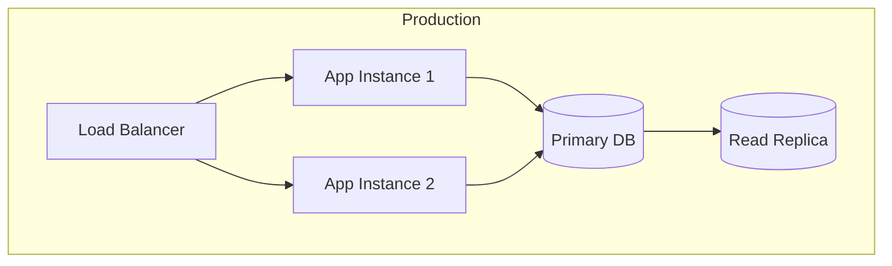

# 03 System Design

<!--
SDLC POSITION: This template is step 3 of 9 and covers system design only.
System design takes 02-Architecture constraints and applies them to real-world infrastructure.
Software architecture (code organization, modules, seams) lives in 02, not here.
Per-module detail lives in 02 section 5.5 module cards, not here.
SLOs defined here are verified by 06-Review-QA, rollout detail lives in 07-Staging and 08-Release.
SCALABLE DETAIL: not every project needs all sections.
MVP or prototype: Overview plus Capacity plus Resilience.
Production service: add Data plus Caching plus Topology plus Operability.
Complex system: full document.
Delete subsections that do not apply, keep headings stable for link anchors.
-->

## Overview

<!--
PURPOSE: 2-3 sentences that answer "what scale problem this design solves and within which architecture".
AUDIENCE: Anyone who lands on this document.
-->

{{Brief description of the scale challenge and the infrastructure shape answering it}}.
{{Which architecture document and slices this design constrains, with a link to 02-Architecture}}.

---

## Document Navigation

| Sections | Content | Audience |
|----------|---------|----------|
| 1-2 | Capacity, SLOs, data and storage | Architects,developers |
| 3-5 | Caching, concurrency, resilience | Developers |
| 6-8 | Topology, operability, security boundaries | DevOps, SRE |
| 9 | Scale risks and open items | Tech leads, architects |

---

## 1. Capacity and SLOs

<!--
PURPOSE: Turn quality goals into load numbers before choosing infrastructure.
RULE: Every SLO needs a verification hook in 06, an SLO without one blocks APPROVE.
Current truth versus planned target must be explicit when they differ.
-->

- Load: {{e.g. concurrent users, requests per second, peak multiplier}}.
- Latency budget: {{e.g. p95 per endpoint plus per-model-call budget}}.
- Availability target: {{e.g. uptime plus recovery time}}.

| SLO | Target | Verified by |
|-----|--------|-------------|
| {{e.g. chat p95}} | {{e.g. under 2s at 50 RPS}} | {{06 case id}} |
| {{e.g. fallback success}} | {{e.g. 99 percent of retryable errors degrade gracefully}} | {{06 case id}} |

---

## 2. Data and Storage

<!--
PURPOSE: Lock engine choice, replication, and consistency before code depends on them.
Ownership plus retention per entity lives in 02 section 5.4, keep this to scale mechanics.
-->

- Engine: {{e.g. Postgres plus pgvector, why over the rejected alternative}}.
- Replication: {{e.g. primary plus replica, failover behavior}}.
- Consistency: {{what is strongly versus eventually consistent}}.
- Migrations: {{owner, exclusion rules, e.g. never touch framework tables}}.
- Retention: {{per entity or store, what expires and when}}.

---

## 3. Caching

<!--
PURPOSE: Define layers, keys, and invalidation so cache behavior is predictable and tenant-safe.
-->

- Layers: {{e.g. shared cache plus local in-memory fallback}}.
- Keys: {{naming scheme plus scoping, e.g. per user identifier}}.
- TTL: {{per entry kind, e.g. 60 seconds for recall}}.
- Invalidation: {{how entries expire or are evicted}}.
- Fallback: {{behavior on cache miss or cache outage}}.

- RULE: Never cache errors.
- RULE: Scope keys so tenants cannot read each other.

---

## 4. Concurrency and Messaging

<!--
PURPOSE: Name every parallel and background path so load has no surprises.
Guards against unbounded loops belong here, not in code review hindsight.
-->

- Parallel work: {{e.g. concurrent tool calls, fan-out workers plus aggregator}}.
- Background work: {{e.g. memory writes after the reply, failures logged and ignored}}.
- Queues: {{which async handoffs exist, delete this line when there are none}}.
- Limits: {{max parallelism, iteration guards, e.g. grader accepts last draft below 3}}.

---

## 5. Resilience

<!--
PURPOSE: Define how the system bends without breaking, per dependency.
Scenario flows live in 02 section 6, keep this to budgets and policies.
-->

- Retry: {{per-dependency backoff, max attempts, total budget}}.
- Fallback: {{order, when traffic moves, e.g. circular provider walk}}.
- Breaker: {{when and how}}.
- Degradation: {{what the user sees when a dependency is down}}.
- Timeouts: {{per-call and total budgets}}.

---

## 6. Deployment Topology

<!--
PURPOSE: Map software to infrastructure.
Rollout staging plus rollback detail lives in 07-Staging and 08-Release, not here.
-->

| Service | Port | Purpose |
|---------|------|---------|
| {{App}} | {{e.g. 8000}} | {{HTTP layer}} |
| {{Store}} | {{e.g. 5432}} | {{Data plus vectors}} |
| {{Cache}} | {{e.g. 6379}} | {{Shared cache}} |
| {{Metrics}} | {{e.g. 9090}} | {{Scrape target}} |

- Parity: {{per-stage env files, hostname differences between compose and localhost}}.
- Current truth: {{what runs today versus the planned target above}}.

---

## 7. Operability

<!--
PURPOSE: Wire logs, metrics, and traces to the topology so production is observable from day one.
Dashboard contents plus alert thresholds are decided here and built in 05-Code.
-->

- Logging: {{format per env, context fields on every line}}.
- Metrics: {{signals measured, dashboards, alerting thresholds}}.
- Tracing: {{what each span records, correlation identifiers, disable flag}}.
- Profiles: {{debug-only slow-request handling, how they join to logs and traces}}.

---

## 8. Security Boundaries

<!--
PURPOSE: Draw network and secret boundaries, code-level auth rules live in 02 sections 7 and 8.
-->

- Network: {{what is reachable from where}}.
- Secrets: {{how provided, never in image layers, never committed}}.
- Scopes: {{token kinds enforced per route, cross-link 02 for rule detail}}.
- Rate limits: {{which routes, what happens on excess}}.

---

## 9. Risks and Open Items

<!--
RULE: A risk without mitigation blocks APPROVE.
Systemic risks live in 02 section 11, per-slice delivery risks live in 04-Plan.
Keep this section to scale and infrastructure risks only.
-->

| Risk | Probability | Impact | Mitigation |
|------|-------------|--------|------------|
| {{Risk 1}} | High, Medium, or Low | High, Medium, or Low | {{Plan}} |
| {{Risk 2}} | {{Probability}} | {{Impact}} | {{Plan}} |

- Open: {{undecided value}} - Owner: {{name}} - Due: {{date}}.

---

## Document Metadata

<!--
Update Last Updated on every meaningful change.
Keep section headings stable, they serve as anchors for links from code and ADRs.
-->

- **Version**: {{1.0}}.
- **Last Updated**: {{YYYY-MM-DD}}.
- **Owner**: {{Name or Team}}.
- **Status**: Draft or Active or Deprecated.
